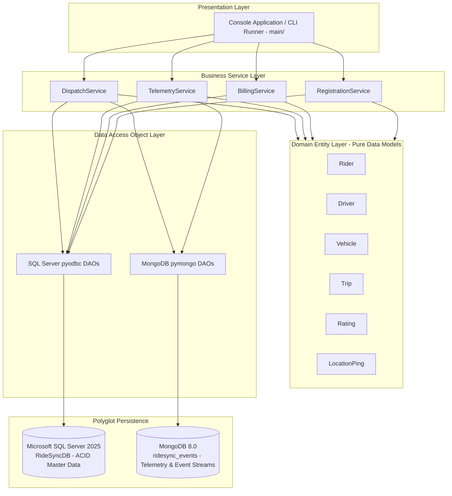

# RideSync — System Architecture Specification

**Document Reference:** `DOC-04-ARCH`  
**System Name:** RideSync (Real-Time Ride-Hailing Dispatch and Live Tracking System)  
**Client:** UrbanGo Mobility  

---

## 1. Architectural Style & Principles

RideSync adheres to a **Layered Domain-Driven Architecture (N-Tier)** integrated with **Polyglot Persistence**.

---

## 2. Layer Responsibilities & Separation of Concerns

1. **Entity Layer (`entity/`):** Pure Python 3 dataclasses representing business records. Contains no SQL strings, database connections, or HTTP logic.
2. **Data Access Object Layer (`dao/`):** Encapsulates all query execution, parameterized SQL commands, stored procedure invocations, and MongoDB BSON document transformations.
3. **Service Layer (`service/`):** Coordinates multi-step transactional business logic (e.g., verifying driver eligibility, calculating great-circle distance, triggering atomic dispatch, generating billing receipts).
4. **Exception Layer (`exception/`):** Strongly typed domain exceptions (`DuplicateEntityError`, `DriverUnavailableError`, `AtomicDispatchConflictError`) protecting business boundaries.
5. **Utility Layer (`util/`):** Thread-safe connection factories and connection pools for `pyodbc` and `pymongo`.

---

## 3. Polyglot Persistence Strategy

| Data Category | Target Database Engine | Access Pattern | Storage Rationale |
| :--- | :--- | :--- | :--- |
| **Master Entities** (Riders, Drivers, Vehicles) | Microsoft SQL Server 2025 | Low write, high read, strict relational integrity | ACID transactions, foreign keys, unique license plates & phone numbers. |
| **Financial & Contracts** (Trips, Fares, Ratings) | Microsoft SQL Server 2025 | High read/write with strict isolation | Pessimistic concurrency locks (`UPDLOCK, HOLDLOCK`) prevent double-booking. |
| **Live Telemetry** (Continuous GPS pings) | MongoDB 8.0 (`driver_location_events`) | High write frequency (every 2–3s) | 2dsphere indexing, high-velocity append, TTL automatic purging after 7 days. |
| **Audit Trails** (State transition events) | MongoDB 8.0 (`ride_activity_logs`) | Append-only document writes | Schema-flexible JSON payloads for diverse IoT and app lifecycle metadata. |
