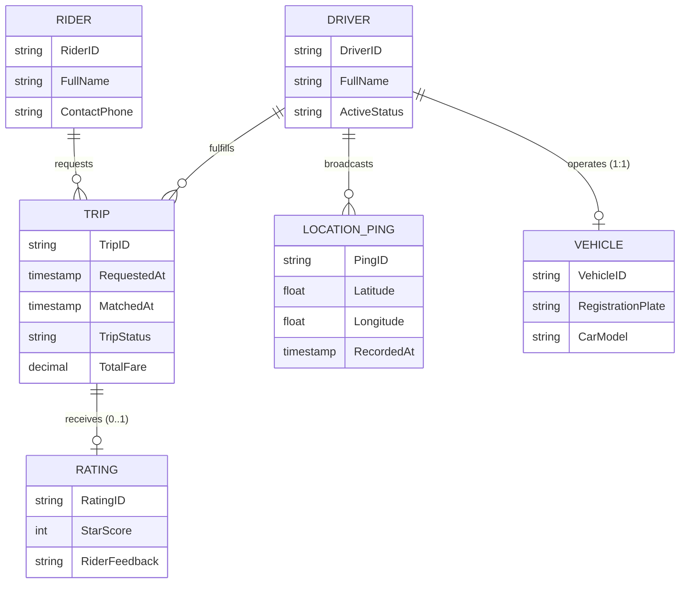
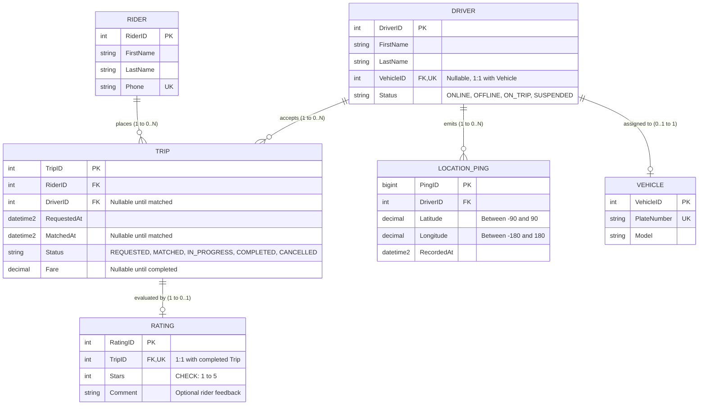
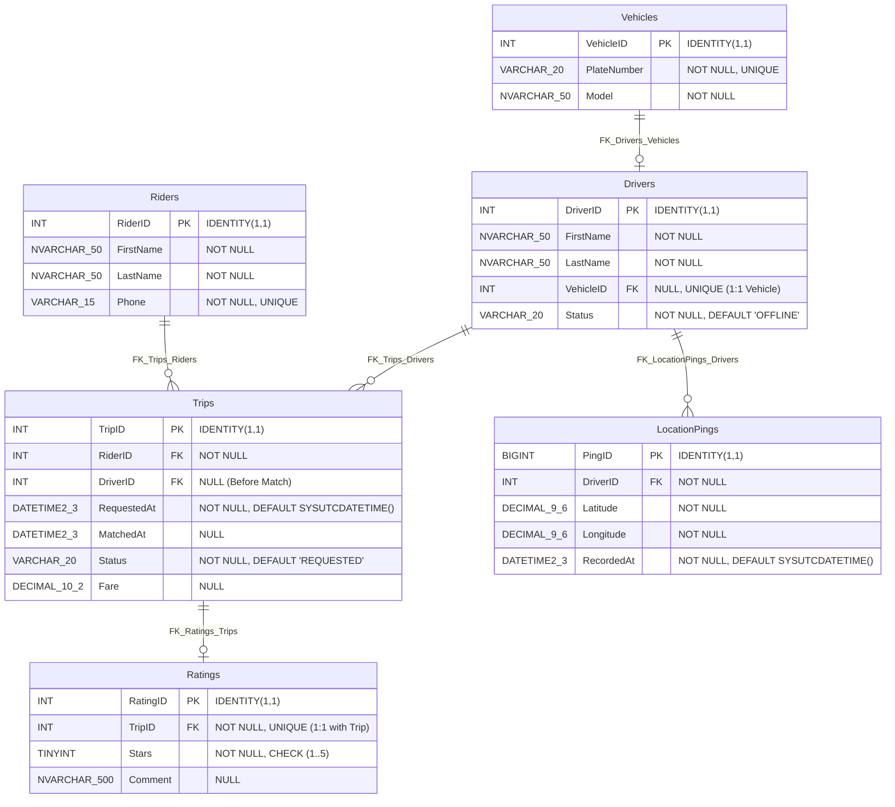

# RideSync — Entity Relationship (ER) Diagrams & Data Models

**Document Reference:** `DOC-06-ERD`  
**System:** RideSync (UrbanGo Mobility)  
**Database Name:** `RideSyncDB`  
**Target RDBMS:** Microsoft SQL Server 2025 (v17)  

---

## 1. Executive Summary & Resolution of Ambiguity

The RideSync database architecture is built around **exactly six core entities**, strictly conforming to the original project requirements.

### Reconciliation of Section 3.1 vs Section 3.2
- **Section 3.1 (Entities):** Includes `VehicleID` inside the `Driver` entity.
- **Section 3.2 (Relationships):** Expressly details 4 narrative relationships:
  1. Rider to Trip ($1 : M$)
  2. Driver to Trip ($1 : M$)
  3. Driver to LocationPing ($1 : M$)
  4. Trip to Rating ($1 : 1 \text{ or } 1 : 0..1$)
- **Reconciliation Decision:** 
  The presence of `VehicleID` in `Driver` mandates an explicit 5th relational link: `Driver.VehicleID` references `Vehicle.VehicleID`. By enforcing a `UNIQUE` constraint on `Driver.VehicleID` while allowing `NULL` during driver registration before vehicle verification, we establish a clean **$1:1$ Optional** relationship. This prevents two active drivers from being assigned to the same vehicle concurrently.

---

## 2. Conceptual ER Diagram

The Conceptual ERD shows high-level business entities and their semantic relationships without technical keys or implementation data types.

---

## 3. Logical ER Diagram

The Logical ERD introduces relational primary keys, foreign keys, logical domain rules, cardinalities, and optionality.

---

## 4. Physical Database Schema Diagram

The Physical Schema illustrates the exact SQL Server 2025 implementation types, IDENTITY specifications, nullability, and index constraints.

---

## 5. Relationship Cardinality & Business Rules Summary

| Relationship | Parent Entity | Child Entity | Cardinality | Enforced By | Business Integrity Rule |
| :--- | :--- | :--- | :---: | :--- | :--- |
| **Driver–Vehicle** | `Vehicles` | `Drivers` | $1 : 0..1$ | `FK_Drivers_Vehicles` + `UQ_Drivers_VehicleID` | A driver may be registered before vehicle assignment. One vehicle cannot be operated by two drivers concurrently. |
| **Rider–Trip** | `Riders` | `Trips` | $1 : 0..N$ | `FK_Trips_Riders` | A rider can place multiple trip requests over time. Trip cannot exist without a valid registered rider. |
| **Driver–Trip** | `Drivers` | `Trips` | $1 : 0..N$ | `FK_Trips_Drivers` | A driver fulfills zero or many trips over their lifetime. `DriverID` is nullable during the initial `REQUESTED` stage. |
| **Driver–LocationPing** | `Drivers` | `LocationPings` | $1 : 0..N$ | `FK_LocationPings_Drivers` | Active drivers continuously stream location pings every 2–3s. Historical telemetry links to the driver. |
| **Trip–Rating** | `Trips` | `Ratings` | $1 : 0..1$ | `FK_Ratings_Trips` + `UQ_Ratings_TripID` | Each trip can receive at most one rating after completion. Duplicate ratings for the same trip are blocked. |
